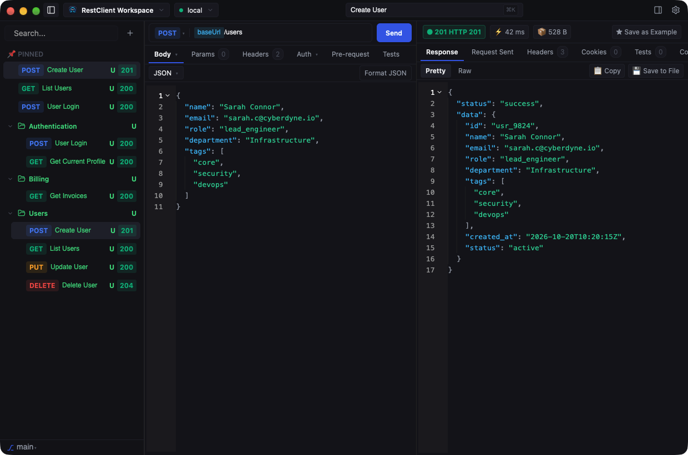

# RestClient: High-Performance Desktop REST API Client in Rust

A fast, lightweight, and Git-friendly desktop REST API client (inspired by Yaak, Insomnia, and Bruno) built in **Rust** using Zed's **GPUI** UI framework and `gpui-component`.

Targeted for **macOS** and **Windows** with real HTTP request execution from the ground up and plain-text filesystem persistence designed for seamless Git collaboration.

<p align="center">
  
</p>

---

## ✨ Key Features

- ⚡ **Native GPUI Performance:** Hardware-accelerated 60–120 FPS rendering, zero webview overhead, instant startup, and tiny memory footprint.
- 💾 **100% Filesystem-First:** Workspace data lives as clean, human-readable YAML files. No hidden SQLite database or proprietary locks.
- 🐙 **Built-in Git Source Control GUI:** Staging, diff viewer, commit history, branch switcher, and remote sync (`push`/`pull`/`fetch`) right inside the app (`Cmd+Shift+G`).
- 📥 **Universal Importers:** Direct support for OpenAPI 3.0/3.1 (JSON & YAML), Postman Collection v2.1, and bidirectional cURL CLI command translation (`Cmd+I`).
- 🖱️ **Fluid Drag-and-Drop Organization:** Drag requests and folders with live dropzone indicators, folder nesting, and root un-nesting.
- 📜 **QuickJS Scripting Sandbox:** Embedded ECMAScript engine with `pm.*` Postman-compatible APIs, crypto helpers, Faker dynamic variables (`{{$guid}}`, `{{$randomEmail}}`), and test assertion runners.
- 🔒 **Zero-Leak Secret Separation:** Environment files only commit variable definitions; actual secret values remain strictly local in `.local/secrets/`.

---

## ⚡ Performance & Resource Comparison

| Metric / Specification | **RestClient** | **Bruno** | **Insomnia** | **Postman** |
|---|:---:|:---:|:---:|:---:|
| **Architecture & Engine** | **Native Rust + GPUI** | Electron + React | Electron + React | Electron (Chromium + Node) |
| **Idle RAM Usage** | **~35 – 50 MB** | ~200 – 400 MB | ~450 – 800 MB | ~800 MB – 1.5 GB+ |
| **Active / Load RAM Usage** | **~60 – 120 MB** | ~350 – 600 MB | ~700 MB – 1.4 GB | ~1.2 – 2.5 GB+ |
| **Disk Space / Installed Size** | **~35 – 50 MB** | ~200 – 300 MB | ~350 – 500 MB | ~500 – 800 MB+ |
| **Cold Startup Time** | **< 0.2s (Instant)** | ~1.5 – 3s | ~2.5 – 5s | ~4 – 8s+ |
| **UI Rendering Engine** | **Hardware-accelerated GPU** | Chromium Webview | Chromium Webview | Chromium Webview |
| **Storage & Privacy** | **100% Local (YAML files)** | 100% Local (`.bru` files) | Cloud Sync / Login (v8+) | Mandatory Cloud & Account |
| **Git Integration** | **Native In-App GUI** (`Cmd+Shift+G`) | External Git tool | Proprietary Git / Inso CLI | Cloud Team Workspaces |

> [!TIP]
> **Why is RestClient so lightweight compared to traditional API clients?**
> - **Zero Electron / Chromium Overhead:** Traditional API clients bundle a full Chromium browser and Node.js runtime, consuming hundreds of megabytes of disk space and gigabytes of RAM. RestClient is compiled directly to native machine code with Zed's GPU-accelerated **GPUI** framework.
> - **Dual-Bounded Memory Cache:** All responses, parsed trees, and historical states are managed through bounded LRU memory caches with strict capacity limits, preventing memory bloat during heavy workloads.
> - **Sub-second Cold Start:** With zero JavaScript bundle parsing and zero Chromium initialization, the application opens and is ready to execute requests in under 200 milliseconds.

---

## 🎨 Visual Design

- **Dark Navy Aesthetic:** Deep navy background (`~#1b1b2a`), panels (`#1e1e2f`), subtle 1px borders (`#2c2c42`), 8px border radius, and blue primary buttons (`#2f6bff`).
- **Method Badges:** GET (Purple `#a855f7`), POST (Green `#22c55e`), PUT (Blue `#3b82f6`), DELETE (Red `#ef4444`), PATCH (Yellow `#eab308`).
- **Status Indicators:** 2xx Green, 3xx Blue, 4xx Orange, 5xx Red.
- **Typography:** System monospace for URLs, headers, bodies, JSON, and curl previews; sans-serif for UI labels and titles.

---

## 💾 Filesystem-First Architecture (100% Plain Text)

The filesystem is the **only source of truth** for collections, environments, and workspace configurations. There is no hidden database or proprietary cache holding collection data.

### On-Disk Workspace Layout

```
my-workspace/
  workspace.yaml                 # version, name, default_environment
  .gitignore                     # auto-managed: contains `.local/` and `*.loc`
  environments/
    local.yaml                   # COMMIT: variables; secret variables store NAME only
    staging.yaml
  collections/
    auth/                        # group = directory
      _folder.yaml               # name, order: [login, refresh, logout] (stems)
      login.yaml                 # COMMIT: request + examples
      login.loc                  # GITIGNORE: last response cache (same stem as the yaml)
      refresh.yaml
    health/
      _folder.yaml
      healthz.yaml
  .local/                        # GITIGNORE: personal machine data
    secrets/local.yaml           # secret variable VALUES per environment
    cookies.json                 # cookie jar; expired cookies dropped on save
    pins.yaml                    # ordered relative request paths
    state.yaml                   # active request, environment, layout, recents
```

App-level global settings (recent workspace paths, theme, window geometry) live in a single JSON file in the OS config directory (`dirs::config_dir()`), never inside the workspace repository.

---

## 🤝 Git Collaboration Workflow

### What to Commit vs What to Gitignore
- **Committed Files:**
  - `workspace.yaml`: Workspace metadata and default environment.
  - `environments/*.yaml`: Environment variable declarations. Variables flagged as `secret: true` store **names only** without values.
  - `collections/**/<slug>.yaml`: Requests, settings, scripts, and saved examples.
  - `collections/**/_folder.yaml`: Folder display names and manual request ordering.
- **Gitignored Files (`.local/` and `*.loc`):**
  - `.local/secrets/<env>.yaml`: Actual secret variable values. Never committed.
  - `.local/cookies.json`: Personal cookie jars.
  - `.local/pins.yaml` and `.local/state.yaml`: Individual window, selection, and UI preferences.
  - `*.loc`: Last response caches (JSON format, truncated at 512KB for large payloads; binary bodies store metadata only).

### Deterministic Serialization
To prevent noisy diffs and merge conflicts when working in teams:
1. **Deterministic YAML:** 2-space indentation, trailing newline, strictly Unix LF line endings (even on Windows).
2. **Fixed Key Ordering:** `name`, `method`, `url`, `params`, `headers`, `auth`, `body`, `settings`, `script`, with `examples` **always last**.
3. **No Random IDs:** Request file paths use slugs (`login.yaml`, `login-2.yaml`). Pairing with `.loc` response cache is by exact stem match only.
4. **Unknown Key Preservation:** Preserves unknown keys when saving (flattened map), ensuring newer teammates' schema extensions are never stripped.
5. **Atomic Writes:** All filesystem mutations write to a temporary file in the same directory first, then perform an atomic rename with a 5x retry loop on Windows sharing violations.

### Automatic Protection & Conflict Handling
- **Auto-managed `.gitignore`:** Upon opening a workspace, `.gitignore` is created or verified to ensure `.local/` and `*.loc` are present.
- **Tracked Secret Warning:** If a Git repository is detected and sensitive paths (`.local/` or `*.loc`) are tracked by Git, a persistent warning toast alerts the user.
- **External Change Detection:** Background `notify` watcher automatically reloads changed files. If an external change modifies a file while the user has unsaved edits in memory, a conflict banner allows choosing **"Reload"** or **"Keep mine"**.
- **Parse Error Resilience:** Invalid YAML syntax from Git merge conflicts or edits does not crash the app. The sidebar displays an error icon, the editor presents an error banner with the exact line number, and the last good in-memory version is retained.

---

## 🧱 Codebase Structure

The project is structured as a Cargo virtual workspace with clean separation between UI and the storage trait:

```
restclient/
├── crates/
│   ├── core/                  # Pure business logic, models, executor, storage
│   │   ├── src/
│   │   │   ├── curl/          # cURL CLI importer and exporter
│   │   │   ├── git/           # Git integration (status, diffs, branches, stage, commit, sync)
│   │   │   ├── http/          # HttpExecutor trait & ReqwestExecutor with timing breakdowns
│   │   │   ├── importers/     # OpenAPI 3.0/3.1 & Postman v2.1 collection parsers and workspace importer
│   │   │   ├── interpolation.rs # {{var}} interpolation & syntax scanning
│   │   │   ├── models.rs      # Data models (HttpRequestItem, HttpMethod, Auth, etc.)
│   │   │   ├── scripting/     # Embedded QuickJS (rquickjs) sandbox, API bridge, faker
│   │   │   └── storage/       # Filesystem persistence implementation
│   │   │       ├── fs_ops.rs      # Single-code-path filesystem CRUD operations
│   │   │       ├── fs_store.rs    # FsWorkspaceStore implementing WorkspaceStore trait
│   │   │       ├── models.rs      # Plain serde YAML/JSON models
│   │   │       ├── serialize.rs   # Deterministic LF serialization & atomic write with retry
│   │   │       ├── slug.rs        # Slugs, stem matching, collisions
│   │   │       ├── traits.rs      # WorkspaceStore trait
│   │   │       └── watcher.rs     # Debounced notify filesystem watcher & path suppression
│   │   └── Cargo.toml
│   └── app/                   # GPUI desktop application
│       ├── src/
│       │   ├── app/           # AppView, RequestComposer, ComposerInputs, InspectorDisplays, Subscriptions
│       │   ├── components/    # Reusable UI widgets (ResponseInspector, Sidebar, Modals, StatusBadge)
│       │   ├── platform/      # macOS vs Windows caption buttons & git branch chip
│       │   ├── services/      # Decoupled execution services (HttpEngine, Runner)
│       │   ├── settings.rs    # OS config directory AppSettings
│       │   ├── state/         # Fine-grained entity states (AppState, WorkspaceDataState, RequestSessionState, ResponseState)
│       │   ├── theme.rs       # Theme tokens & palettes
│       │   └── main.rs        # App entry point, menus, keyboard shortcuts, split layouts
│       └── Cargo.toml
├── Cargo.toml                 # Workspace root
└── README.md
```

---

## ⌨️ Keyboard Shortcuts

| Shortcut | Action |
|---|---|
| `Ctrl + Enter` (or `Cmd + Enter`) | Send active request (or Cancel if in-flight) |
| `Ctrl + K` (or `Cmd + K`) | Toggle Command Palette |
| `Ctrl + B` (or `Cmd + B`) | Toggle Sidebar visibility |
| `Ctrl + Shift + G` (or `Cmd + Shift + G`) | Toggle Git Source Control Panel (Commit, Diff, History, Branch) |
| `Ctrl + I` (or `Cmd + I`) | Open Import Modal (OpenAPI & Postman) |
| `Ctrl + ,` (or `Cmd + ,`) | Open Settings Modal |
| `Ctrl + [` (or `Cmd + [`) | Navigate back in request history |
| `Ctrl + ]` (or `Cmd + ]`) | Navigate forward in request history |
| `Escape` | Dismiss modal / Command Palette |

---

## 🚀 Building & Running

### Requirements
- Rust stable (2021 edition)
- Windows 10/11 or macOS 12+

### Run Development
```bash
cargo run -p restclient
```

### Build Optimized Release
```bash
cargo build --release -p restclient
```

### Run Test Suite
```bash
cargo test --workspace
```

### Run Linter
```bash
cargo clippy --workspace --all-targets -- -D warnings
```

---

## 🗺️ Roadmap & Current Gaps

1. **AST Code-Folding in Response Viewer:**
   - *Current status:* High-performance code editor view with syntax coloring, line numbers, and automatic fallback to a 120 FPS virtualized list (`uniform_list`) for large payloads (>2,000 lines).
   - *Next step:* Full recursive AST syntax folding on brace blocks when `gpui-component` editor AST folding stabilizes.
2. **WebSocket & Server-Sent Events (SSE) Streaming:**
   - *Current status:* Complete support for HTTP/1.1 and HTTP/2 REST requests with timing breakdowns.
   - *Planned:* Real-time bidirectional streaming connections for WebSockets and SSE event feeds.
3. **GraphQL Visual Query Builder:**
   - *Current status:* GraphQL queries can be executed via standard POST JSON requests.
   - *Planned:* Schema introspection, autocomplete, and a visual query/variables builder.
