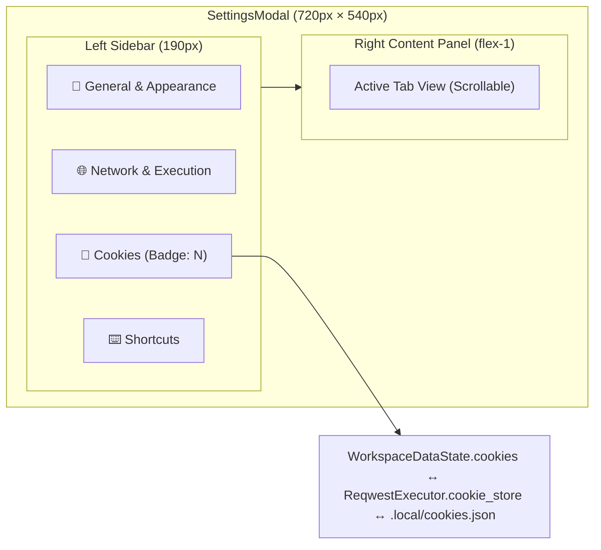

# Refactor Settings Modal into Multi-Tab Layout with Integrated Cookie Manager

## Goal Description

Refactor the monolithic `SettingsModal` (822 LOC in a single vertical scroll view) into a clean, modular **multi-tab Settings dialog** featuring a macOS/Zed-style **left vertical sidebar navigation + right content panel**.

Replace the separate placeholder `CookiesModal` with a dedicated **`Cookies` tab** directly inside Settings that connects to the live HTTP `ReqwestExecutor` cookie jar and `.local/cookies.json`, enabling users to inspect, search/filter, copy, delete individual cookies, or clear all cookies in one place.

---

## Architecture & UI Layout

### Key Architectural Decisions
1. **Modular Component Structure (< 650 LOC per file)**:
   - Split `crates/app/src/components/settings_modal.rs` into `crates/app/src/components/settings_modal/`:
     - `mod.rs`: Modal container, header, left sidebar tab navigation, footer, and tab content dispatcher.
     - `general_tab.rs`: Theme Mode (`System`, `Dark`, `Light`), Split Layout (`Horizontal` vs `Vertical`), and Active Workspace & Storage metadata with quick "Open Folder" button.
     - `network_tab.rs`: Active Request indicator, Request Timeout presets (`10s`, `30s`, `60s`, `120s`), Follow HTTP Redirects, and Validate SSL/TLS Certificates.
     - `cookies_tab.rs`: Search/filter input, cookie count summary, "Clear All" button, and cookie list with domain/path/security badges, Copy Value button, and per-cookie Delete button.
     - `shortcuts_tab.rs`: Keyboard shortcuts reference table.
2. **Eliminate Redundant `CookiesModal`**:
   - Delete `crates/app/src/components/cookies_modal.rs` and remove `show_cookies_modal` from `ModalState`.
   - Add `SettingsTab` enum (`General`, `Network`, `Cookies`, `Shortcuts`) to `ModalState` so any caller (e.g., Command Palette) can open Settings directly to `SettingsTab::Cookies`.
3. **Live Cookie Jar Synchronization**:
   - Introduce `StoredCookie` in `restclient_core::models` with `name`, `value`, `domain`, `path`, `expires`, `secure`, `http_only`, `same_site`.
   - Share the `Arc<ReqwestExecutor>` between `WorkspaceDataState` and `HttpEngine`.
   - Sync cookies from `ReqwestExecutor` into `WorkspaceDataState::cookies` and `.local/cookies.json` after each HTTP response and upon cookie deletion/clearing.

---

## Step-by-Step Implementation Tasks

1. **Core Models & HTTP Cookie Store (`crates/core`)**:
   - Add `StoredCookie` to `crates/core/src/models.rs`.
   - Add `get_stored_cookies()`, `remove_cookie()`, and `restore_stored_cookies()` to `ReqwestExecutor` in `crates/core/src/http/executor.rs`.
2. **Application State & Runner (`crates/app/src/state` & `services`)**:
   - Update `ModalState` (`crates/app/src/state/modal_state.rs`) with `SettingsTab` and `cookie_filter_query`, removing `show_cookies_modal`.
   - Update `WorkspaceDataState` & `workspace_crud.rs` to hold `executor: Arc<ReqwestExecutor>` and `cookies: Vec<StoredCookie>`, syncing with `.local/cookies.json`.
   - Connect `Runner` and `AppView` to use the workspace's `ReqwestExecutor` and sync cookies after responses.
3. **Multi-Tab Settings Modal UI (`crates/app/src/components/settings_modal/`)**:
   - Create modular `mod.rs`, `general_tab.rs`, `network_tab.rs`, `cookies_tab.rs`, `shortcuts_tab.rs`.
   - Delete `crates/app/src/components/cookies_modal.rs` and old `crates/app/src/components/settings_modal.rs`.
   - Update `crates/app/src/components/mod.rs`, `crates/app/src/app/modals.rs`, and `crates/app/src/components/command_palette.rs`.

---

## Verification Steps

1. Run `cargo fmt --check`
2. Run `cargo test`
3. Run `cargo clippy --all-targets -- -D warnings`
