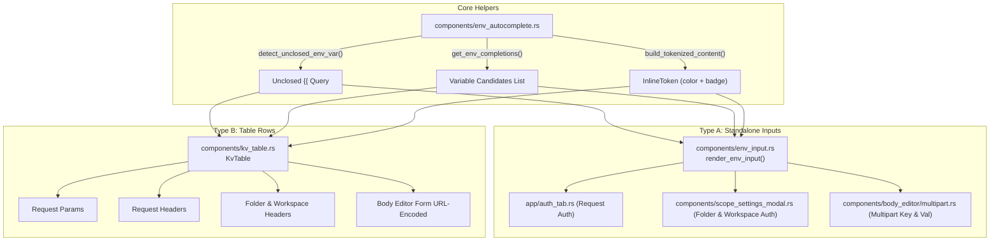

# Implementation Plan - Unified Environment Variable Autocomplete & Tag System Across All Inputs

## Goal Description
Across the application, user inputs that accept environment variables (format `{{var}}`) currently have inconsistent support:
- **Folder Settings & Workspace Settings (Auth)**: Completely missing autocomplete suggestions popup and inline token tag pill rendering.
- **Body Editor - Multipart Form (`multipart/form-data`)**: Key and Value inputs are plain text inputs with no autocomplete, no token tag rendering, no hover cards, and no environment modal link.
- **Body Editor - Form URL-Encoded (`x-www-form-urlencoded`)**: Uses `KvTable` but lacks `modal_state`, preventing users from clicking tokens to open the environment modal.
- **Params & Headers & Scope Headers (`KvTable`)**: Computes autocomplete suggestions from the static `pairs` property rather than live `InputState` value during typing, which can lead to delayed or missed autocomplete dropdown triggers. Typing closing `}}` does not automatically convert plain text to tag pills until selection or refresh.

This plan delivers a **unified, thorough solution** across all input surfaces:
1. **Request Params** (Query parameters table)
2. **Request Headers** (Headers table)
3. **Request Auth** (Bearer, Basic, API Key)
4. **Folder Settings** (Headers table + Auth inputs)
5. **Workspace Settings** (Headers table + Auth inputs)
6. **Body Editor** (`x-www-form-urlencoded` table & `multipart/form-data` rows)

---

## User Review Required
> [!IMPORTANT]
> - **Unified `EnvInput` Component**: We introduce `crates/app/src/components/env_input.rs` (`render_env_input`, aliased to `render_auth_input`), providing a single reusable element for any standalone input requiring autocomplete, hover preview cards, click-to-edit modal, and tag pill styling.
> - **Live Autocomplete in `KvTable`**: `KvTable` will inspect the live `InputState` content for unclosed `{{` prefixes during typing instead of relying on external props, ensuring 100% instant suggestion dropdowns across Params, Headers, and Form URL-encoded bodies.
> - **Full Auto-Tokenization on Typing `}}`**: In addition to clicking autocomplete suggestions, typing the closing `}}` or pasting `{{var}}` will immediately convert the expression into a tag pill.

---

## Architecture & Integration Map



---

## Proposed Changes

### 1. Unified Standalone Input Component

#### [NEW] `crates/app/src/components/env_input.rs`
- Generalize the existing `render_auth_input` from `crates/app/src/app/auth_input.rs` into `render_env_input`:
  ```rust
  pub fn render_env_input<F>(
      input_id: impl Into<gpui::SharedString>,
      input_state: &Entity<InputState>,
      env_state: Option<&Entity<EnvironmentState>>,
      modal_state: Option<&Entity<ModalState>>,
      window: &mut Window,
      cx: &mut App,
      on_update: F,
  ) -> impl IntoElement
  where
      F: 'static + Clone + Fn(String, &mut Window, &mut App);
  ```
- Export alias `pub use render_env_input as render_auth_input;`.
- Features:
  - Dynamic inspection of `input_state.read(cx).value()`.
  - Floating autocomplete popup dropdown when unclosed `{{prefix` is detected.
  - Hover tooltip card showing resolved value, scope, and resolution status.
  - Token click listener opening `modal_state.toggle_env_modal(cx)`.
  - Immediate `build_tokenized_content` conversion and `on_update` callback on candidate selection.

#### [MODIFY] `crates/app/src/components/mod.rs`
- Add `pub mod env_input;` and `pub use env_input::*;`.

#### [MODIFY] `crates/app/src/app/auth_input.rs`
- Re-export `pub use crate::components::env_input::*;` for backward compatibility.

---

### 2. Table Rows (`KvTable`)

#### [MODIFY] `crates/app/src/components/kv_table.rs`
- **Live Autocomplete**: Instead of calculating `key_completions` and `val_completions` from `self.pairs` at the top of `render()`, compute them per-row using the live values from `key_input.read(cx).value()` and `val_input.read(cx).value()`.
- **Auto-Tokenize on Typing `}}`**: In `sub1` (key input subscription) and `sub2` (val input subscription):
  - When `k.contains("}}") && detect_unclosed_env_var(&k).is_none()`, re-tokenize `key_input` via `build_tokenized_content(&k, env)`.
  - When `v.contains("}}") && detect_unclosed_env_var(&v).is_none()`, re-tokenize `val_input` via `build_tokenized_content(&v, env)`.

---

### 3. Folder & Workspace Settings (`ScopeSettingsModal`)

#### [MODIFY] `crates/app/src/components/scope_settings_modal.rs`
- Import `use crate::components::env_input::render_env_input;` and `use crate::components::env_autocomplete::{build_tokenized_content, detect_unclosed_env_var};`.
- **Input State Initialization**: In `bearer_token_holder`, `basic_user_holder`, `basic_pass_holder`, `api_key_holder`, and `api_val_holder`:
  - Initialize `InputState` with `build_tokenized_content(&init_val, env)` so existing saved variables show as tag pills upon opening the modal.
  - In `InputEvent::Change` subscription: auto-tokenize input when completing `}}` or pasting variables.
- **Rendering**: Replace raw `Input::new` with `render_env_input`:
  - Bearer Token: `render_env_input("scope-auth-bearer-token", &bearer_input, Some(&self.env_state), Some(&self.modal_state), window, cx, on_bearer_update)`
  - Basic Auth: `render_env_input("scope-auth-basic-user", ...)` and `render_env_input("scope-auth-basic-pass", ...)`
  - API Key: `render_env_input("scope-auth-apikey-key", ...)` and `render_env_input("scope-auth-apikey-val", ...)`

---

### 4. Body Editor Form Types (`form.rs` & `multipart.rs`)

#### [MODIFY] `crates/app/src/components/body_editor/mod.rs`
- Add `modal_state: Option<Entity<ModalState>>` field and builder method `.modal_state(Entity<ModalState>)`.
- Forward `modal_state` and `env_state` into `render_form_editor` and `render_multipart_editor`.

#### [MODIFY] `crates/app/src/app/request_composer.rs`
- In `RequestTabKind::Body`, pass `.modal_state(self.state.modal.clone())` to `BodyEditor`.

#### [MODIFY] `crates/app/src/components/body_editor/form.rs`
- Update `render_form_editor` signature to accept `modal_state: Option<&Entity<ModalState>>`.
- Pass `.optional_modal_state(modal_state.cloned())` to `KvTable` so token clicks open the environment modal.

#### [MODIFY] `crates/app/src/components/body_editor/multipart.rs`
- Update `render_multipart_editor` signature to accept `env_state: Option<&Entity<EnvironmentState>>` and `modal_state: Option<&Entity<ModalState>>`.
- In `mp_holder`, initialize `key_input` and `val_input` with `build_tokenized_content(&init_val, env)`.
- In row rendering: replace raw `gpui_component::input::Input::new(&key_input)` and `Input::new(&val_input)` with `render_env_input`.
- In change subscriptions: auto-tokenize when typing `}}`.

---

## Verification Plan

### Automated Tests
1. Run all existing tests across core and app:
   ```bash
   cargo test
   ```
2. Run strict Clippy check:
   ```bash
   cargo clippy --all-targets -- -D warnings
   ```
3. Add unit test covering:
   - `build_tokenized_content` on multipart and scope settings auth strings.
   - Live unclosed variable detection in multi-field tables.

### Manual Verification
1. **Folder Settings & Workspace Settings**:
   - Open Folder Settings -> Auth -> API Key.
   - In `Value:`, type `{{` -> check that suggestions dropdown appears.
   - Click a suggestion -> check that it becomes a colored tag pill and is persisted.
   - Hover tag -> check tooltip card.
   - Click tag -> check that Environment Modal opens.
   - Type closing `}}` manually in `Key:` -> check that it converts into a tag pill.
2. **Params & Headers**:
   - In Request Composer, add a parameter. Type `{{` in Key and Value -> check instant autocomplete dropdown.
   - Click an item or type `}}` -> check tag pill conversion.
3. **Body Editor - Form URL-Encoded**:
   - Select Body -> Form URL-Encoded.
   - Type `{{` in Key or Value -> check autocomplete dropdown.
   - Click an existing tag pill -> check that Environment Modal opens.
4. **Body Editor - Multipart**:
   - Select Body -> Multipart.
   - Type `{{` in Key or Text Value -> check autocomplete dropdown.
   - Click suggestion -> check tag pill conversion.
   - Hover and click tag pill -> check tooltip and modal opening.
