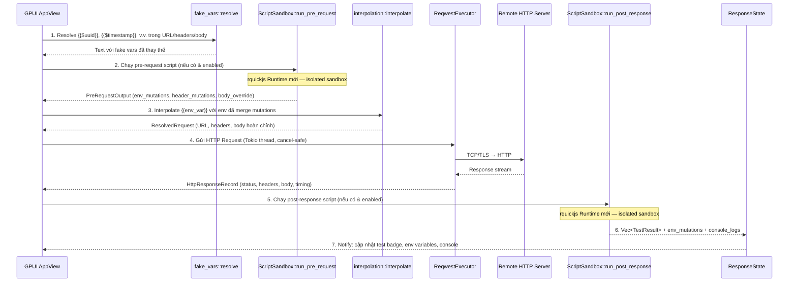

# Đặc tả Kỹ thuật: Scripting Engine, Kiểm thử & Tự động nối Request (Scripting & Automation Engine)

## 1. Tầm quan trọng của Scripting
Trong kiểm thử API thực tế, các requests hiếm khi đứng độc lập. Một quy trình phổ biến luôn bao gồm:
1. Gửi request `POST /auth/login` với username/password.
2. Server phản hồi chứa JSON `{ "token": "ey..." }`.
3. Script tự động đọc `token`, lưu vào biến môi trường `{{access_token}}`.
4. Các request tiếp theo (ví dụ: `GET /users/me`) sử dụng `Authorization: Bearer {{access_token}}` mà không cần người dùng copy-paste thủ công bằng tay.

Tương tự, với Pre-request scripts:
- Tự động sinh `X-Timestamp` (thời gian hiện tại).
- Tự động tính chữ ký mật mã `HMAC-SHA256(secret, timestamp + body)` trước khi gửi lên API thanh toán/ngân hàng.

---

## 2. Kiến trúc Engine Thực thi Script (`restclient-core::scripting`)

### 2.1 Lựa chọn Runtime: `rquickjs`

| Tiêu chí | **QuickJS (`rquickjs`)** ✅ CHỌN | **Boa Engine (`boa_engine`)** | **Rhai (`rhai`)** |
|---|---|---|---|
| **Ngôn ngữ script** | JavaScript ES2020 chuẩn | JavaScript ES6+ | Ngôn ngữ giống Rust/JS |
| **Tương thích Postman** | **Rất cao** — chạy được script `pm.*` gốc | Cao | Thấp — phải viết lại |
| **Tốc độ khởi tạo context** | **Cực nhanh (< 0.5ms)** | Trung bình (~2ms) | Siêu nhanh (< 0.2ms) |
| **Kích thước binary tăng thêm** | **~1.5 MB** (C bindings qua `libquickjs`) | ~12 MB (Pure Rust) | ~1.8 MB (Pure Rust) |
| **Sandbox / Isolation** | Mỗi `Runtime` + `Context` riêng biệt cho từng request | Mỗi `Context` riêng | `Engine` với `Scope` |
| **Hệ sinh thái** | Mature, được dùng rộng rãi (Deno, Cloudflare trước V8 isolates) | Còn đang phát triển | Ổn định |

**Quyết định:** Sử dụng **`rquickjs`** vì:
- Binary nhỏ hơn 8x so với `boa_engine` — quan trọng với mục tiêu < 50MB RAM
- Khởi tạo context cực nhanh: mỗi request spawn một sandbox mới trong < 0.5ms
- Khả năng tương thích Postman scripts cao nhất — người dùng migration không cần sửa script
- QuickJS đã battle-tested (engine của Fabrice Bellard, tác giả QEMU/FFmpeg)

### 2.2 Yêu cầu Build

`rquickjs` sử dụng C bindings. Cần đảm bảo:
- **Windows:** MSVC toolchain (đã có, dùng để build GPUI)
- **macOS:** Clang (đã có qua Xcode Command Line Tools)
- Build script trong `rquickjs` tự bundle `libquickjs.c` — không cần cài thêm thư viện hệ thống

Dependencies bổ sung trong `crates/core/Cargo.toml`:
```toml
# JavaScript scripting runtime (QuickJS via safe Rust bindings)
rquickjs = { version = "0.8", features = ["full", "loader", "futures"] }

# Crypto utilities cho client.crypto.*
hmac     = "0.12"
sha2     = "0.10"
md-5     = "0.10"
hex      = "0.4"
rand     = { version = "0.8", features = ["std", "std_rng"] }
```

---

## 3. Thiết kế Cấu trúc Dữ liệu & Model

Trong `crates/core/src/models.rs`, bổ sung các type sau:

```rust
/// Cấu hình script gắn với một HttpRequestItem — được serialize vào file JSON
#[derive(Debug, Clone, Serialize, Deserialize, Default, PartialEq, Eq)]
pub struct ScriptConfig {
    /// Code JS chạy TRƯỚC khi gửi request (có thể thay đổi headers, body)
    #[serde(default, skip_serializing_if = "Option::is_none")]
    pub pre_request: Option<String>,
    /// Code JS chạy SAU khi nhận response (test assertions + request chaining)
    #[serde(default, skip_serializing_if = "Option::is_none")]
    pub post_response: Option<String>,
    /// Master switch: false = bỏ qua cả hai script
    #[serde(default = "default_true")]
    pub enabled: bool,
}

/// Kết quả của một lần gọi `client.test("name", fn)` trong post-response script
#[derive(Debug, Clone, Serialize, Deserialize, PartialEq, Eq)]
pub struct TestResult {
    pub name: String,
    pub passed: bool,
    #[serde(default, skip_serializing_if = "Option::is_none")]
    pub error_message: Option<String>,
    /// Thời gian thực thi hàm test (ms)
    pub duration_ms: u64,
}
```

Thêm fields vào các struct hiện có:

```rust
// Trong HttpRequestItem — backward-compatible vì #[serde(default)]
#[serde(default, skip_serializing_if = "Option::is_none")]
pub script: Option<ScriptConfig>,

// Trong HttpResponseRecord — không phải lưu DB, chỉ in-memory
#[serde(default, skip_serializing_if = "Vec::is_empty")]
pub test_results: Vec<TestResult>,
```

---

## 4. Kiến trúc Module `crates/core/src/scripting/`

```
crates/core/src/scripting/
├── mod.rs          — public exports
├── api.rs          — Rust structs trao đổi dữ liệu vào/ra sandbox
├── fake_vars.rs    — Resolve {{$uuid}}, {{$timestamp}}, {{$randomInt}}, v.v.
└── sandbox.rs      — rquickjs Runtime + Context, inject client.* API
```

### 4.1 Module `fake_vars.rs`

Pure Rust, không phụ thuộc rquickjs. Chạy trước bước interpolate env vars:

```rust
use uuid::Uuid;
use chrono::Utc;
use rand::Rng;

/// Danh sách Dynamic Variables được hỗ trợ:
/// {{$uuid}} / {{$guid}}       → UUID v4, e.g. "550e8400-e29b-41d4-a716-446655440000"
/// {{$timestamp}}              → Unix epoch integer, e.g. "1728870000"
/// {{$isoTimestamp}}           → ISO 8601 UTC, e.g. "2026-10-14T02:00:00.000Z"
/// {{$randomInt}}              → Số nguyên ngẫu nhiên 1–1000
/// {{$randomEmail}}            → Email giả, e.g. "user4521@example.com"
/// {{$randomName}}             → Tên ngẫu nhiên từ wordlist
/// {{$randomPhoneNumber}}      → Số điện thoại Việt Nam giả

pub fn resolve_fake_vars(text: &str) -> String { /* ... */ }
```

### 4.2 Module `api.rs`

Các struct Rust không phụ thuộc rquickjs — dùng để truyền dữ liệu vào/ra sandbox:

```rust
/// Context truyền vào sandbox khi chạy pre-request script
pub struct PreRequestContext {
    pub env_vars: Vec<EnvironmentVariable>,
    pub request_headers: Vec<KeyValuePair>,
    pub request_body_json: Option<String>,
}

/// Kết quả sandbox trả về sau pre-request script
pub struct PreRequestOutput {
    pub env_mutations: Vec<(String, Option<String>)>, // (key, Some(val)|None=unset)
    pub header_mutations: Vec<(String, String)>,       // header thêm/override
    pub body_override: Option<String>,                 // nếu script ghi đè body JSON
    pub error: Option<String>,                         // lỗi script (không crash app)
}

/// Context truyền vào sandbox khi chạy post-response script
pub struct PostResponseContext {
    pub env_vars: Vec<EnvironmentVariable>,
    pub status_code: u16,
    pub response_time_ms: u64,
    pub response_headers: Vec<(String, String)>,
    pub response_body: String,                         // UTF-8, tối đa 10MB truncated
}

/// Kết quả sandbox trả về sau post-response script
pub struct PostResponseOutput {
    pub env_mutations: Vec<(String, Option<String>)>,
    pub test_results: Vec<TestResult>,
    pub console_logs: Vec<String>,
    pub error: Option<String>,
}
```

### 4.3 Module `sandbox.rs` — rquickjs Integration

Mỗi lần gọi script tạo một `rquickjs::Runtime` + `Context` mới, hoàn toàn độc lập:

```rust
use rquickjs::{Context, Runtime, Object, Function, Value};

pub struct ScriptSandbox;

impl ScriptSandbox {
    /// Chạy pre-request script. Trả về Ok(output) hoặc Err(script_error_string).
    pub fn run_pre_request(
        code: &str,
        ctx_data: PreRequestContext,
    ) -> PreRequestOutput {
        let rt = Runtime::new().expect("QuickJS runtime init failed");
        let ctx = Context::full(&rt).expect("QuickJS context init failed");

        ctx.with(|ctx| {
            // 1. Tạo shared mutation stores
            let env_mutations: Rc<RefCell<Vec<(String, Option<String>)>>> = Default::default();
            let header_mutations: Rc<RefCell<Vec<(String, String)>>> = Default::default();
            let body_override: Rc<RefCell<Option<String>>> = Default::default();
            let console_logs: Rc<RefCell<Vec<String>>> = Default::default();

            // 2. Inject toàn bộ client.* API
            let client_obj = build_client_object(&ctx, &ctx_data, &env_mutations, &header_mutations, &body_override);
            ctx.globals().set("client", client_obj).unwrap();
            ctx.globals().set("pm", ctx.globals().get::<_, Object>("client").unwrap()).unwrap(); // pm alias

            // 3. Inject console.log
            inject_console(&ctx, &console_logs);

            // 4. Eval script
            let result = ctx.eval::<Value, _>(code);

            // 5. Extract output
            match result {
                Ok(_) => PreRequestOutput {
                    env_mutations: env_mutations.borrow().clone(),
                    header_mutations: header_mutations.borrow().clone(),
                    body_override: body_override.borrow().clone(),
                    error: None,
                },
                Err(e) => PreRequestOutput {
                    error: Some(format_js_error(e)),
                    ..Default::default()
                },
            }
        })
    }

    pub fn run_post_response(
        code: &str,
        ctx_data: PostResponseContext,
    ) -> PostResponseOutput { /* tương tự */ }
}

/// Các hàm client.crypto.* được bind từ native Rust functions:
/// - hmacSha256(secret: string, data: string) → hex string
/// - md5(data: string) → hex string  
/// - base64Encode(str: string) → base64 string
/// - base64Decode(str: string) → string
fn bind_crypto_functions(ctx: &rquickjs::Ctx, crypto_obj: &Object) { /* ... */ }
```

---

## 5. Đặc tả API JavaScript Sandbox (`client.*` & `pm.*`)

RestClient cung cấp đối tượng toàn cục `client` (và alias `pm` để tương thích ngược script cũ của Postman):

### 5.1 Quản lý Biến Môi Trường (Variables & Environment)
```javascript
// Đọc biến môi trường hiện tại
const baseUrl = client.environment.get("base_url");

// Gán biến môi trường (persist vào active environment sau khi request hoàn tất)
client.environment.set("access_token", "jwt_token_here");

// Xóa biến môi trường
client.environment.unset("temp_token");

// Lấy biến toàn cục / workspace (read-only)
client.variables.get("api_key");
```

### 5.2 Truy cập Thông Tin Request (Trong Pre-request Script)
```javascript
// Thêm header động
client.request.headers.add("X-Request-Timestamp", Date.now().toString());

// Thay đổi body JSON trước khi gửi
let body = client.request.body.json();
body.nonce = Math.random().toString(36).substring(7);
client.request.body.setJson(body);
```

### 5.3 Thư viện Mật mã Built-in (Crypto Utility)

Các hàm crypto được bind trực tiếp từ native Rust (hmac, sha2, md-5, base64 crates). Không cần `require()`:

```javascript
// HMAC-SHA256 — dùng cho API chữ ký (payment, banking, v.v.)
const signature = client.crypto.hmacSha256("my_secret_key", timestamp + body);

// MD5 hash
const md5Hash = client.crypto.md5(data);

// Base64 encode / decode
const encoded = client.crypto.base64Encode(rawText);
const decoded = client.crypto.base64Decode(encoded);
```

### 5.4 Truy cập Response (Trong Post-response Script)
```javascript
client.response.status            // number: HTTP status code (200, 404, ...)
client.response.time              // number: tổng thời gian ms
client.response.headers["content-type"]  // string
client.response.json()            // Object: parse JSON body
client.response.text()            // string: raw body text
```

### 5.5 Viết Test Assertions (Trong Post-response Script)
```javascript
client.test("Status code is 200 OK", function () {
    client.assert(client.response.status === 200, "Expected 200 but got " + client.response.status);
});

client.test("Response time is under 500ms", function () {
    client.assert(client.response.time < 500);
});

client.test("Verify user profile in JSON", function () {
    const json = client.response.json();
    client.assert(json.id !== undefined, "User ID is required");
    client.assert(json.email.includes("@"), "Email must be valid");

    // Tự động chain token cho request tiếp theo
    if (json.access_token) {
        client.environment.set("access_token", json.access_token);
    }
});

// console.log output hiện trong tab "Tests" / Console Output
console.log("Token received:", client.response.json().access_token);
```

### 5.6 Dynamic Fake Variables

Các biến này được resolve bởi Rust trước khi script chạy (không phải trong JS):

| Variable | Giá trị sinh ra | Ví dụ |
|---|---|---|
| `{{$uuid}}` / `{{$guid}}` | UUID v4 | `550e8400-e29b-41d4-a716-446655440000` |
| `{{$timestamp}}` | Unix epoch (giây) | `1728870000` |
| `{{$isoTimestamp}}` | ISO 8601 UTC | `2026-10-14T02:00:00.000Z` |
| `{{$randomInt}}` | Số nguyên 1–1000 | `742` |
| `{{$randomEmail}}` | Email giả | `user4521@example.com` |
| `{{$randomName}}` | Tên người ngẫu nhiên | `Diana` |
| `{{$randomPhoneNumber}}` | Số Việt Nam giả | `+84987654321` |

---

## 6. Quy trình Thực thi Request kèm Scripts (Execution Lifecycle)



---

## 7. Giao diện Người dùng trong RestClient (UI Components)

### 7.1 Tab "Pre-request Script" & "Tests" trong Request Editor

Thêm 2 tab mới vào `RequestTabKind`:
- **Pre-request Script:** Editor JS với snippet toolbar bên phải (gợi ý nhanh: "Set timestamp header", "HMAC signature", "Add random nonce")
- **Tests:** Editor JS với snippet toolbar ("Status is 200", "Set env var from response", "JSON field check")

### 7.2 Tab "Tests" trong Response Viewer

Hiển thị tổng quan và chi tiết kết quả sau mỗi lần gửi request:

```
┌─────────────────────────────────────────────────┐
│  Tests (3/3) ●                                  │  ← badge xanh nếu all pass
│              hoặc  Tests (2/3) ●                │  ← badge đỏ nếu có fail
├─────────────────────────────────────────────────┤
│  ✓  Status code is 200 OK              0ms      │
│  ✓  Response time under 500ms          0ms      │
│  ✗  User ID is required                1ms      │
│     ↳ Assertion failed: expected truthy value   │
├─────────────────────────────────────────────────┤
│  Console Output                                  │
│  > Token received: eyJhbGci...                  │
└─────────────────────────────────────────────────┘
```

### 7.3 Script Error Indicator

Nếu script throw error hoặc có syntax error, hiện:
- Icon `⚠` màu vàng trên tab "Pre-request Script" / "Tests"
- Toast notification ngắn gọn: "Pre-request script error: Unexpected token '}' at line 5"
- Error message chi tiết bên trong tab editor (dưới code)
