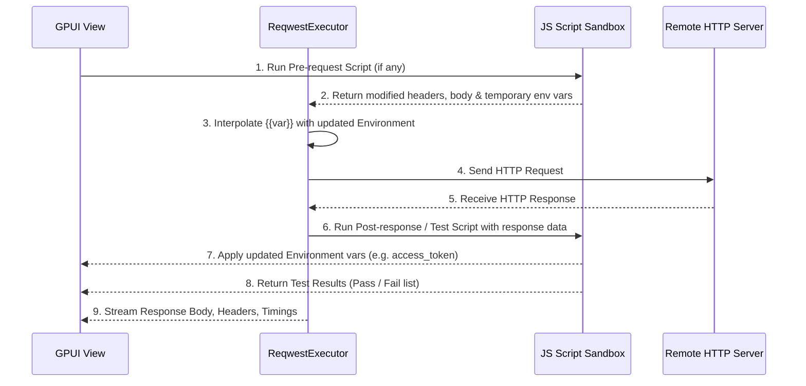

# Đặc tả Kỹ thuật: Scripting Engine, Kiểm thử & Tự động nối Request (Scripting & Automation Engine)

## 1. Tầm quan trọng của Scripting
Trong kiểm thử API thực tế, các requests hiếm khi đứng độc lập. Một quy trình phổ biến luôn bao gồm:
1. Gửi request `POST /auth/login` với username/password.
2. Server phản hồi chứa JSON `{ "token": "ey..." }`.
3. Script tự động đọc `token`, lưu vào biến môi trường `{{access_token}}`.
4. Các request tiếp theo (ví dụ: `GET /users/me`) sử dụng `Authorization: Bearer {{access_token}}` mà không cần người dùng copy-paste thủ công bằng tay.

Tương tự, với Pre-request scripts:
- Tự động sinh `X-Timestamp` (thời gian hiện tại).
- Tự động tính chữ ký mật mã `HMAC-SHA256(secret, timestamp + body)` trước khi gửi lên API thanh toán/ngân hàng.

---

## 2. Kiến trúc Engine Thực thi Script (`restclient-core::scripting`)

### 2.1 Lựa chọn Runtime trong Rust
Có 2 giải pháp tối ưu cho ứng dụng Desktop native viết bằng Rust:

| Tiêu chí | **QuickJS (`rquickjs`)** | **Boa Engine (`boa_engine`)** | **Rhai (`rhai`)** |
|---|---|---|---|
| **Ngôn ngữ** | Chuẩn JavaScript ES2020 | Chuẩn JavaScript ES6+ | Ngôn ngữ scripting nhúng giống Rust/JS |
| **Tương thích Postman** | **Rất cao (chạy được script Postman)** | Cao | Phải học cú pháp Rhai |
| **Tốc độ khởi tạo context** | **Cực nhanh (< 0.5ms)** | Trung bình (~2ms) | Siêu nhanh (< 0.2ms) |
| **Kích thước nhị phân** | ~1.5 MB C bindings | ~12 MB Pure Rust | ~1.8 MB Pure Rust |
| **Độ an toàn / Sandbox** | Đóng gói an toàn trong C context | 100% Memory safe Pure Rust | 100% Memory safe Pure Rust |

**Khuyến nghị:**
- Sử dụng **`boa_engine`** (hoặc `rquickjs`) để hỗ trợ cú pháp JavaScript chuẩn quen thuộc với lập trình viên Postman (`pm.*` hoặc `client.*`).

---

## 3. Thiết kế Cấu trúc Dữ liệu & Model

Trong `crates/core/src/models.rs`, bổ sung vào `HttpRequestItem`:

```rust
#[derive(Debug, Clone, Serialize, Deserialize, Default)]
pub struct ScriptConfig {
    pub pre_request: Option<String>,
    pub post_response: Option<String>,
    pub enabled: bool,
}

#[derive(Debug, Clone, Serialize, Deserialize)]
pub struct TestResult {
    pub name: String,
    pub passed: bool,
    pub error_message: Option<String>,
    pub duration_ms: u64,
}
```

---

## 4. Đặc tả API JavaScript Sandbox (`client.*` & `pm.*`)

RestClient cung cấp đối tượng toàn cục `client` (và alias `pm` để tương thích ngược script cũ của Postman):

### 4.1 Quản lý Biến Môi Trường (Variables & Environment)
```javascript
// Đọc biến môi trường hiện tại
const baseUrl = client.environment.get("base_url");

// Gán biến môi trường (Lưu vào active environment sau khi request hoàn tất)
client.environment.set("access_token", "jwt_token_here");

// Xóa biến môi trường
client.environment.unset("temp_token");

// Lấy biến toàn cục / workspace
client.variables.get("api_key");
```

### 4.2 Truy cập Thông Tin Request (Trong Pre-request Script)
```javascript
// Thay đổi header động
client.request.headers.add("X-Request-Timestamp", Date.now().toString());

// Thay đổi body trước khi gửi
let body = client.request.body.json();
body.nonce = Math.random().toString(36).substring(7);
client.request.body.setJson(body);
```

### 4.3 Thư viện Mật mã Built-in (Crypto Utility)
Tích hợp sẵn các hàm mã hóa thông dụng không cần `require()`:
```javascript
const signature = client.crypto.hmacSha256("my_secret_key", payload);
const md5Hash = client.crypto.md5(data);
const base64Str = client.crypto.base64Encode(rawText);
```

### 4.4 Viết Test Assertions (Trong Post-response Script)
```javascript
client.test("Status code is 200 OK", function () {
    client.assert(client.response.status === 200, "Expected 200 but got " + client.response.status);
});

client.test("Response time is under 500ms", function () {
    client.assert(client.response.time < 500);
});

client.test("Verify user profile in JSON", function () {
    const json = client.response.json();
    client.assert(json.id !== undefined, "User ID is required");
    client.assert(json.email.includes("@"), "Email must be valid");
    
    // Tự động chain token cho request tiếp theo
    if (json.access_token) {
        client.environment.set("access_token", json.access_token);
    }
});
```

---

## 5. Quy trình Thực thi Request kèm Scripts (Execution Lifecycle)



---

## 6. Giao diện Người dùng trong RestClient (UI Components)

1. **Tab "Pre-request Script" & "Tests" trong Request Editor:**
   - Editor code JavaScript có syntax highlight, bracket match và gợi ý snippet nhanh ở thanh công cụ bên phải (ví dụ: `Status code: 200`, `Set an environment variable`, `Response body: JSON check`).
2. **Tab "Tests" trong Response Viewer:**
   - Hiển thị tổng quan: `Tests (3/3)` màu xanh lá nếu đỗ hết, hoặc `Tests (2/3)` màu đỏ nếu có test trượt.
   - Chi tiết danh sách từng bài kiểm tra, icon tick xanh `✓` hoặc gạch chéo đỏ `✗` kèm thông báo lỗi chi tiết.
