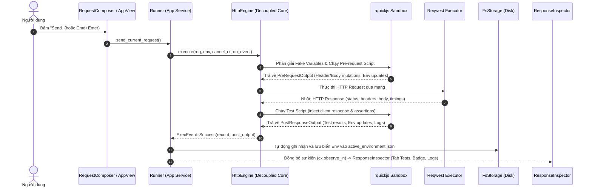

# Chi Tiết Triển Khai Giai Đoạn 1: Scripting, Tự Động Hóa & Request Chaining

> **Trạng thái:** ✅ Đã hoàn thành (100% Implemented & Tested)  
> **Phiên bản:** v0.2.0  
> **Engine cốt lõi:** `rquickjs` v0.8 (Embedded QuickJS JavaScript Engine)

---

## 1. Tổng Quan & Mục Tiêu

Giai đoạn 1 mang lại khả năng tự động hóa và lập trình linh hoạt cho **Zest**, đạt được mức độ tương thích cao với **Postman** (`pm.*`) và **Insomnia**:
1. **Pre-request Scripts:** Chạy mã JavaScript trước khi gửi request để thêm header động, sinh HMAC signature, tính toán timestamp hoặc chuẩn bị payload.
2. **Post-response Scripts (Tests & Assertions):** Kiểm tra tính hợp lệ của HTTP Response (Status code, Headers, JSON Schema, nội dung phản hồi).
3. **Request Chaining:** Tự động trích xuất token/dữ liệu từ response và lưu ngược vào Active Environment để các request tiếp theo tự động sử dụng.
4. **Dynamic Fake Variables (Faker built-in):** Hỗ trợ macro biến ngẫu nhiên trực tiếp trong URL, Headers, Params, Body (`{{$uuid}}`, `{{$timestamp}}`, `{{$randomEmail}}`, ...).
5. **UI Tương Tác Trực Quan:** Bổ sung tab soạn thảo Pre-request / Tests kèm danh mục Snippet mẫu bên phải, và tab kết quả Tests chi tiết kèm Console Logs trong Response Viewer.

---

## 2. Lựa Chọn Kỹ Thuật: QuickJS (`rquickjs`)

Thay vì các engine nặng nề hoặc runtime hạn chế, dự án quyết định tích hợp **`rquickjs`** vì các ưu điểm vượt trội:
- **Thời gian khởi tạo cực nhanh:** < 0.5ms cho một Sandbox Runtime mới, đảm bảo hoàn toàn độc lập giữa các request mà không gây độ trễ.
- **Dung lượng nhị phân nhẹ:** Chỉ tăng binary thêm ~1.5MB.
- **Hỗ trợ ES2023 hiện đại:** Arrow functions, destructuring, template literals, `JSON.parse/stringify`, `Date.now()`, `Math.*`.
- **An toàn & Độc lập:** Mỗi lần thực thi script là một `Runtime` và `Context` riêng biệt, không có quyền truy cập vào Filesystem hay Network tùy tiện, ngăn chặn hoàn toàn rủi ro bảo mật từ các collection bên thứ ba.

---

## 3. Kiến Trúc API JavaScript (`client.*` & `pm.*`)

Zest cung cấp đầy đủ API tương thích cả hai chuẩn `client.*` (chuẩn Zest) và `pm.*` (chuẩn Postman):

### 3.1. Quản Lý Biến Môi Trường (`client.environment` & `client.variables`)
- `client.environment.get(key: string): string | null`: Lấy giá trị biến môi trường.
- `client.environment.set(key: string, value: any): void`: Đặt hoặc cập nhật biến môi trường. Biến này sẽ tự động được đồng bộ vào file cấu hình môi trường đang kích hoạt trên đĩa.
- `client.environment.unset(key: string): void`: Xóa một biến khỏi môi trường.
- `client.variables.get(key: string): string | null`: Đọc biến (ưu tiên Environment).

### 3.2. Tiền Xử Lý Request (`client.request`)
- `client.request.headers.add(name: string, value: string): void`: Thêm hoặc ghi đè header.
- `client.request.headers.set(name: string, value: string): void`: Ghi đè header.
- `client.request.headers.get(name: string): string | null`: Đọc giá trị header.
- `client.request.headers.remove(name: string): void`: Xóa header khỏi request.
- `client.request.body.get(): string`: Lấy nội dung body dạng text.
- `client.request.body.set(newBody: string): void`: Thay thế body của request.
- `client.request.body.json(): any`: Parse nhanh body dạng JSON.

### 3.3. Kiểm Tra Response (`client.response`)
- `client.response.status: number`: Mã trạng thái HTTP (ví dụ `200`, `404`).
- `client.response.responseTime: number`: Thời gian phản hồi tính bằng mili-giây.
- `client.response.headers: Record<string, string>`: Danh sách các response headers.
- `client.response.json(): any`: Parse response body sang JavaScript Object.
- `client.response.text(): string`: Lấy response body nguyên bản dưới dạng chuỗi UTF-8.

### 3.4. Test Suite & Assertions (`client.test`, `client.assert`)
- `client.test(testName: string, testFn: () => void): void`: Khai báo một ca kiểm thử.
- `client.assert(condition: boolean, message?: string): void`: Kiểm tra điều kiện logic; ném lỗi nếu false.
- `console.log(...args: any[]): void`: Ghi log vào console của request, hiển thị trực quan trong tab Tests.

### 3.5. Bộ Công Cụ Mã Hóa (`client.crypto`)
Cung cấp tiện ích mã hóa phục vụ ký API request:
- `client.crypto.hmacSha256(secret: string, message: string): string`: Sinh chuỗi mã HMAC-SHA256 (hex).
- `client.crypto.md5(message: string): string`: Sinh hash MD5 (hex).
- `client.crypto.base64Encode(text: string): string`: Encode Base64.
- `client.crypto.base64Decode(encoded: string): string`: Decode Base64.

---

## 4. Dynamic Fake Variables (Macro Faker)

Hệ thống tự động phân giải các placeholder dạng `{{$macro}}` trước khi chuyển request qua pre-request script hoặc tầng mạng:

| Macro | Mô tả | Ví dụ kết quả |
|---|---|---|
| `{{$uuid}}`, `{{$guid}}` | UUID phiên bản 4 chuẩn RFC 4122 | `c4a760a8-dbcf-5254-a0d9-6a4474bd1b62` |
| `{{$timestamp}}` | Unix Timestamp tính bằng giây | `1728892800` |
| `{{$isoTimestamp}}` | Chuỗi thời gian chuẩn ISO 8601 UTC | `2026-10-14T03:20:00.000Z` |
| `{{$randomInt}}` | Số nguyên ngẫu nhiên từ 1 đến 1000 | `482` |
| `{{$randomEmail}}` | Địa chỉ email mẫu ngẫu nhiên | `user_8371@example.com` |
| `{{$randomName}}` | Họ tên mẫu ngẫu nhiên | `Alice Johnson` |
| `{{$randomPhoneNumber}}` | Số điện thoại ngẫu nhiên | `+1-555-8392` |

---

## 5. Quy Trình Request Chaining Hoàn Chỉnh

Zest tách rời tầng giao diện GPUI và tầng mạng bằng `HttpEngine` độc lập cùng bộ điều phối `Runner`:

---

## 6. Giao Diện Người Dùng (UI/UX)

1. **Thanh Tab Request Composer:**
   - Thêm tab **Pre-request** và **Tests** cạnh Body, Params, Headers, Auth, Settings.
   - Có dấu chấm thông báo (`●`) khi request hiện tại có chứa script.
2. **Sidebar Snippets (Trợ Giúp Viết Code Nhanh):**
   - Click 1 chạm để chèn code mẫu thường dùng:
     - *Pre-request:* Set Timestamp Header, HMAC-SHA256 Signature, Set Env Variable, Mutate JSON Body.
     - *Tests:* Status code is 200, Response time < 500ms, Extract & Set Access Token (Request Chaining), Verify JSON Property, Log Response Body.
3. **Response Inspector — Tab Tests:**
   - Badge tổng kết số lượng test: `Passed 2/2` (màu xanh lá) hoặc `Failed 1/2` (màu đỏ).
   - Danh sách chi tiết từng bài test kèm thời gian thực thi (ms).
   - Hộp cảnh báo lỗi chi tiết khi test thất bại (kèm stack trace/message).
   - Khung **Console Logs** thu gọn/mở rộng hiển thị toàn bộ log xuất ra từ `console.log(...)`.

---

## 7. Kết Quả Kiểm Thử (Verification & Testing)

Tất cả các unit tests và integration tests đều đạt 100% pass rate:
- `test_resolve_fake_vars`: Kiểm tra phân giải UUID, Timestamp, ISO, Random types.
- `test_script_sandbox_pre_request`: Kiểm tra sửa đổi Header và thêm biến môi trường.
- `test_script_sandbox_post_response_tests`: Kiểm tra assertions `client.assert` thành công và thất bại.
- `test_script_sandbox_request_chaining`: Kiểm tra trích xuất token từ response JSON và cập nhật biến `access_token`.
- `test_script_sandbox_crypto`: Kiểm tra tính toán `hmacSha256`, `md5`, `base64Encode`, `base64Decode`.
- `test_pm_alias`: Kiểm tra tính tương thích của alias `pm.*`.
- `test_console_log`: Kiểm tra thu thập log từ `console.log`.
