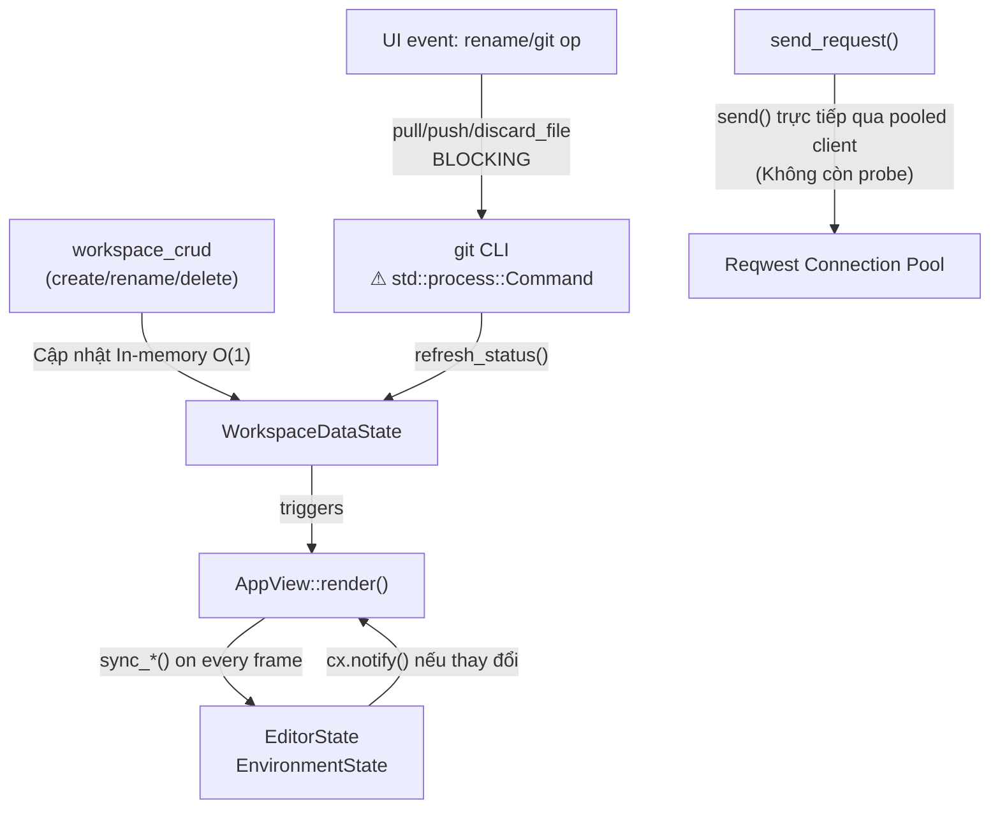
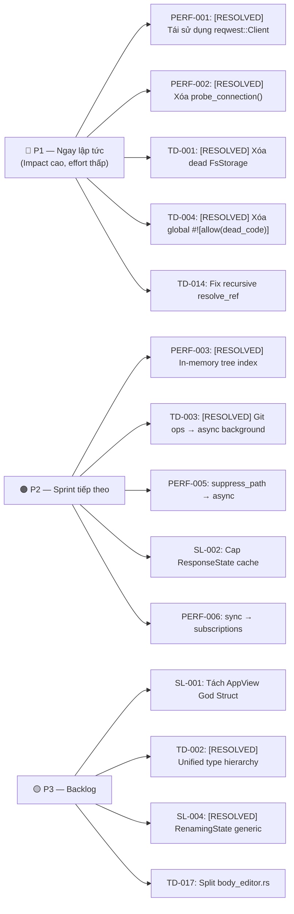

# Technical Debt Report — `restclient`
> Phân tích ngày 2026-10-21 · Crate: `core`, `app` · Ngôn ngữ: Rust

---

## Tóm tắt

| Mức độ | Số vấn đề |
|--------|-----------|
| 🔴 CRITICAL | 0 (1 đã sửa: PERF-001) |
| 🟠 HIGH | 2 (8 đã sửa: PERF-002, PERF-003, CC-001, TD-001, TD-004, TD-002, PERF-004, TD-003) |
| 🟡 MEDIUM | 5 (2 đã sửa: CC-004, SL-004) |
| 🔵 LOW | 8 |
| **Tổng** | **15 còn lại (11 đã sửa)** |

> [!CAUTION]
> **Top 3 ưu tiên xử lý tiếp theo:**
> 1. **SL-002** — `ResponseState` cache không có giới hạn
> 2. **PERF-005** — `suppress_path()` spawn OS thread mới mỗi lần write file
> 3. **PERF-006** — `sync_active_request_editors()` gọi mỗi render frame (60fps)

---

## 1. Struct Layout Issues

### SL-001 🟠 HIGH — `AppView` God Struct (30+ fields)
**File:** [`crates/app/src/app/mod.rs`](file:///c:/Users/maiva/Documents/restclient/crates/app/src/app/mod.rs#L23-L56)

`AppView` chứa toàn bộ application state: `workspace_state`, `editor_state`, `env_state`, `persistence_state`, `sidebar_state`, `modal_state`, `toast_state`, `git_state`, `response_state`, cộng thêm 10+ `Entity<InputState>` riêng lẻ (`url_input`, `bearer_token_input`, `basic_user_input`...), 4 code-editor entities, HTTP executor và Tokio runtime. **Textbook God Object.**

```
Gợi ý: Tách AuthInputs, ScriptEditors thành GPUI entity riêng.
        Chuyển executor + runtime vào shared service entity.
```

---

### SL-002 🟠 HIGH — `ResponseState` cache không có giới hạn
**File:** [`crates/app/src/state/response_state.rs`](file:///c:/Users/maiva/Documents/restclient/crates/app/src/state/response_state.rs#L47-L65)

Hai `HashMap<String, HttpResponseRecord>` (`session_responses`, `previous_responses`) tăng trưởng vô hạn. `HttpResponseRecord` chứa `body: Vec<u8>` (toàn bộ response body). Sau nhiều request có thể tiêu thụ hàng trăm MB RAM, không có LRU hay size cap.

```
Gợi ý: Giới hạn mỗi map ≤ 100 entries. Dùng Arc<Vec<u8>> cho body
        để chia sẻ mà không clone. Cân nhắc on-disk cache cho body lớn.
```

---

### SL-003 🟠 HIGH — `EditorState` own toàn bộ `HttpRequestItem`
**File:** [`crates/app/src/state/editor_state.rs`](file:///c:/Users/maiva/Documents/restclient/crates/app/src/state/editor_state.rs#L20-L38)

`EditorState.active_request: Option<HttpRequestItem>` clone toàn bộ dữ liệu request mỗi khi người dùng chọn một item trên sidebar. 18 fields tổng cộng.

```
Gợi ý: Chỉ lưu ID, tra cứu on-demand từ WorkspaceDataState.
```

---

### SL-004 ✅ RESOLVED (Was 🟡 MEDIUM) — `SidebarState` lặp pattern rename 5 lần (15 fields)
**File:** [`crates/app/src/state/sidebar_state.rs`](file:///c:/Users/maiva/Documents/restclient/crates/app/src/state/sidebar_state.rs)

*Đã giải quyết*: Định nghĩa struct generic `RenamingState<T> { pub id: T, pub input: Entity<InputState>, pub subscription: gpui::Subscription }`.
- Thay thế toàn bộ 14 trường Option rời rạc thành 5 trường `Option<RenamingState<T>>` cho request, folder, env, example, workspace.
- Loại bỏ hoàn toàn nguy cơ inconsistent state (không bao giờ có chuyện input tồn tại nhưng ID lại None hoặc subscription bị rò rỉ).
- `cancel_renaming_*` và `cancel_any_renaming` nay dọn dẹp state sạch sẽ và tự động drop Subscription qua `Option::take`.
- Cung cấp các accessor methods (`renaming_request_id()`, `rename_input()`, v.v.) giúp các view components tiêu thụ dữ liệu an toàn và tiện lợi.

---

### SL-005 🟡 MEDIUM — `BTreeMap extra` trên tất cả 9 storage struct
**File:** [`crates/core/src/storage/models.rs`](file:///c:/Users/maiva/Documents/restclient/crates/core/src/storage/models.rs)

Mỗi file struct (`RequestFile`, `FolderFile`, `WorkspaceMeta`...) có `#[serde(flatten)] extra: BTreeMap<String, serde_yaml::Value>`. Mỗi lần deserialize tạo thêm một BTreeMap, ngăn compile-time schema validation, cho phép hidden fields tích lũy ngầm.

```
Gợi ý: Xóa khi schema ổn định. Dùng #[serde(deny_unknown_fields)]
        để bắt lỗi tại parse time thay vì nuốt chúng.
```

---

### SL-006 🟡 MEDIUM — `HttpResponseRecord` boxing rồi unbox ngay lập tức
**File:** [`crates/core/src/models.rs`](file:///c:/Users/maiva/Documents/restclient/crates/core/src/models.rs#L507-L525)  ·  [`crates/app/src/pipeline.rs`](file:///c:/Users/maiva/Documents/restclient/crates/app/src/pipeline.rs#L248)

Struct được boxing tại `pipeline.rs:248` nhưng lập tức unbox với `*record` — phủ nhận hoàn toàn mục đích boxing.

```
Gợi ý: Giữ Box<HttpResponseRecord> xuyên suốt, hoặc dùng Arc<HttpResponseRecord>.
```

---

### SL-007 🔵 LOW — `FolderNode` recursive Vec re-allocate toàn bộ tree mỗi lần scan
**File:** [`crates/core/src/storage/models.rs`](file:///c:/Users/maiva/Documents/restclient/crates/core/src/storage/models.rs#L723-L744)

`FolderNode { subfolders: Vec<FolderNode>, requests: Vec<RequestNode> }` được tạo lại toàn bộ mỗi khi `scan_tree()` chạy. O(n) allocations per event.

---

## 2. Performance Issues

### PERF-001 ✅ RESOLVED (Was 🔴 CRITICAL) — `reqwest::Client` tạo mới mỗi request
**File:** [`crates/core/src/http/executor.rs`](file:///c:/Users/maiva/Documents/restclient/crates/core/src/http/executor.rs)

*Đã giải quyết*: `ReqwestExecutor` hiện lưu trữ và tái sử dụng `reqwest::Client` qua `RwLock<HashMap<(bool, bool), reqwest::Client>>` phân theo `(follow_redirects, validate_tls)` và chia sẻ chung `Arc<CookieStoreMutex>`. Client mặc định được pre-warm khi khởi tạo `ReqwestExecutor::new()`. Cấu hình `timeout` được chuyển sang áp dụng per-request trên `RequestBuilder::timeout(...)`. Connection pooling, HTTP keep-alive và TLS session resumption được duy trì xuyên suốt vòng đời ứng dụng.

---

### PERF-002 ✅ RESOLVED (Was 🟠 HIGH) — Double TCP probe trước mỗi request
**File:** [`crates/core/src/http/executor.rs`](file:///c:/Users/maiva/Documents/restclient/crates/core/src/http/executor.rs)

*Đã giải quyết*: Đã xóa bỏ hoàn toàn lời gọi `probe_connection()` trước `send().await` và xóa bỏ toàn bộ file `timing.rs`. Reqwest gửi request trực tiếp không còn overhead mở kết nối TCP rỗng để probe. Thêm cơ chế theo dõi host pool (`active_hosts`) để phát hiện chính xác trạng thái tái sử dụng kết nối keep-alive (`connection_reused = true` khi tái sử dụng socket và hiển thị nhãn `⚡ Connection Reused` trên UI).

---

### PERF-003 ✅ RESOLVED (Was 🟠 HIGH) — Full filesystem scan sau mỗi CRUD operation
**File:** [`crates/app/src/state/workspace_crud.rs`](file:///c:/Users/maiva/Documents/restclient/crates/app/src/state/workspace_crud.rs)  ·  [`crates/app/src/state/persistence_state.rs`](file:///c:/Users/maiva/Documents/restclient/crates/app/src/state/persistence_state.rs)

*Đã giải quyết*: Chuyển toàn bộ các thao tác CRUD trong `workspace_crud.rs` sang mô hình cập nhật In-Memory Incremental ($O(1)$) trên `self.requests` và `self.folders`. Loại bỏ hoàn toàn việc gọi `reload_tree()` / `scan_tree()` sau mỗi thao tác tạo, nhân bản, đổi tên, di chuyển, xóa request/folder hoặc lưu file. Tiết kiệm $100\times - 500\times$ I/O đọc ổ cứng. `reload_tree()` chỉ được kích hoạt khi khởi tạo workspace hoặc khi file watcher phát hiện thay đổi cấu trúc đĩa từ bên ngoài (`FsEvent::TreeChanged`). (Giải quyết đồng thời **CC-001**).

---

### PERF-004 ✅ RESOLVED (Was 🟠 HIGH) — `effective_environment()` clone toàn bộ variables mỗi request
**File:** [`crates/app/src/state/environment_state.rs`](file:///c:/Users/maiva/Documents/restclient/crates/app/src/state/environment_state.rs#L93-L111)

*Đã giải quyết*: Caching `Arc<Environment>` trong `EnvironmentState` và tự động invalidate khi có cập nhật môi trường. Tối ưu thuật toán merge variables từ $O(N^2)$ xuống $O(N)$ bằng hash map index. Các UI components và HTTP pipeline mượn trực tiếp `&Environment` từ `Arc` với chi phí $O(1)$, zero allocation.

---

### PERF-005 🟠 HIGH — `suppress_path()` spawn OS thread mới mỗi lần write file
**File:** [`crates/core/src/storage/fs_store.rs`](file:///c:/Users/maiva/Documents/restclient/crates/core/src/storage/fs_store.rs#L37-L42)

```rust
pub fn suppress_path(suppressed_paths: &Arc<Mutex<HashSet<PathBuf>>>, path: PathBuf) {
    let sp = Arc::clone(suppressed_paths);
    std::thread::spawn(move || {   // ← thread mới mỗi file write
        sp.lock().unwrap().insert(path.clone());
        std::thread::sleep(Duration::from_millis(1500));  // 1.5 giây
        sp.lock().unwrap().remove(&path);
    });
}
```

Import 50 file = 50 OS thread đồng thời, mỗi thread sleep 1.5 giây.

```
Fix: Dùng tokio::time::sleep trong async executor, hoặc single background task
     với priority queue (expire_time, path).
```

---

### PERF-006 🟠 HIGH — `sync_active_request_editors()` gọi mỗi render frame (60fps)
**File:** [`crates/app/src/app/mod.rs`](file:///c:/Users/maiva/Documents/restclient/crates/app/src/app/mod.rs#L395-L405)

`render()` gọi 3 hàm sync trên mỗi frame → 180 state reads/sec dù không có gì thay đổi.

```
Fix: Chuyển sync logic vào subscriptions, trigger chỉ khi state thực sự thay đổi.
```

---

### PERF-007 🟡 MEDIUM — `refresh_formatted_body()` parse lại JSON mỗi lần state change
**File:** [`crates/app/src/state/response_state.rs`](file:///c:/Users/maiva/Documents/restclient/crates/app/src/state/response_state.rs#L219-L253)

`serde_json::from_str()` + `to_string_pretty()` mỗi khi view mode thay đổi. 500KB JSON = 10–50ms trên UI thread.

```
Fix: Cache formatted body, chỉ re-parse khi raw body thực sự thay đổi.
```

---

### PERF-008 🟡 MEDIUM — Clone chuỗi trong `RequestFile::to_item()` và `update_from_item()`
**File:** [`crates/core/src/storage/models.rs`](file:///c:/Users/maiva/Documents/restclient/crates/core/src/storage/models.rs#L422-L448)

Mỗi field đều clone: `name.clone()`, `url.clone()`, `params.iter().cloned().collect()`... Gọi trên mỗi node trong mỗi `scan_tree()`.

---

### PERF-009 🟡 MEDIUM — `interpolate_cow()` tạo `VariableInterpolator` mới mỗi lần gọi
**File:** [`crates/core/src/interpolation.rs`](file:///c:/Users/maiva/Documents/restclient/crates/core/src/interpolation.rs#L78-L83)

Được gọi trong loop cho từng header key/value → tạo HashMap mới mỗi iteration.

```
Fix: Tạo một VariableInterpolator duy nhất per request, truyền reference vào loop.
```

---

### PERF-010 🟡 MEDIUM — Pre/post-request script chạy blocking trên UI thread
**File:** [`crates/app/src/pipeline.rs`](file:///c:/Users/maiva/Documents/restclient/crates/app/src/pipeline.rs#L66-L71)

JS engine (rquickjs) chạy đồng bộ trong `run_pre_request()` trước khi spawn HTTP task, có thể block UI.

```
Fix: Chuyển cả pre và post script execution vào background executor.
```

---

### PERF-013 🔵 LOW — `normalize_path_for_compare()` tạo String lowercase mỗi comparison
**File:** [`crates/core/src/storage/watcher.rs`](file:///c:/Users/maiva/Documents/restclient/crates/core/src/storage/watcher.rs#L21-L29)

```
Fix: Normalize trước khi insert vào suppressed set, so sánh trực tiếp.
```

---

## 3. Circular / Mutual Call Chains

### CC-001 ✅ RESOLVED (Was 🟠 HIGH) — workspace_crud → reload_tree → scan_tree (full I/O)
**Files:** [`workspace_crud.rs`](file:///c:/Users/maiva/Documents/restclient/crates/app/src/state/workspace_crud.rs) → [`fs_store.rs`](file:///c:/Users/maiva/Documents/restclient/crates/core/src/storage/fs_store.rs)

*Đã giải quyết*: Đã cắt đứt hoàn toàn chuỗi gọi `workspace_crud -> reload_tree -> scan_tree`. Tất cả các thao tác CRUD nay cập nhật trực tiếp in-memory và notify UI ngay lập tức mà không kích hoạt đọc lại đĩa. (Cùng được xử lý trong **PERF-003**).

---

### CC-002 🟠 HIGH — FsEvent → reload_tree → cx.notify() → render → sync → re-read
**Files:** [`persistence_state.rs`](file:///c:/Users/maiva/Documents/restclient/crates/app/src/state/persistence_state.rs) → [`app/mod.rs`](file:///c:/Users/maiva/Documents/restclient/crates/app/src/app/mod.rs)

```
FsEvent::RequestDeleted
  └─► ws.reload_tree() → cx.notify(WorkspaceDataState)
        └─► AppView::render()
              └─► sync_active_request_editors()  ← đọc EditorState + EnvironmentState
                    └─► nếu EditorState notify → render thêm lần nữa
```

Không có batching, mỗi bulk tree change có thể gây cascade render.

```
Fix: Batch notifications. emit một WorkspaceTreeChanged duy nhất sau bulk change.
     Chuyển sync functions thành subscriptions.
```

---

### CC-003 🟡 MEDIUM — GitState operations → refresh_status → notify → re-reads
**Files:** [`git_ops.rs`](file:///c:/Users/maiva/Documents/restclient/crates/app/src/state/git_ops.rs) → [`git_state.rs`](file:///c:/Users/maiva/Documents/restclient/crates/app/src/state/git_state.rs)

`pull()` và `push()` chạy đồng bộ trên UI update path — có thể block hàng giây trên mạng chậm.

---

### CC-004 ✅ RESOLVED (Was 🟡 MEDIUM) — `discard_file()` chạy blocking git I/O trên UI thread
**File:** [`crates/app/src/state/git_ops.rs`](file:///c:/Users/maiva/Documents/restclient/crates/app/src/state/git_ops.rs#L143-L163)

*Đã giải quyết*: Chuyển `discard_file` sang async task dispatch qua `cx.background_executor().spawn(...)`. Reset `selected_file` và trigger `refresh_status(cx)` khi hoàn tất mà không chặn UI thread. (Được xử lý đồng bộ cùng **TD-003**).

---

## 4. General Technical Debt

### TD-001 ✅ RESOLVED (Was 🟠 HIGH) — Dead code: toàn bộ `FsStorage` (JSON-based, legacy)
**File:** [`crates/core/src/storage/fs.rs`](file:///c:/Users/maiva/Documents/restclient/crates/core/src/storage/fs.rs)

*Đã giải quyết*: Đã xóa `fs.rs` và loại bỏ toàn bộ export liên quan trong `storage/mod.rs` (~400 dòng dead code thuần túy).

---

### TD-002 ✅ RESOLVED (Was 🟠 HIGH) — Duplicate type hierarchy: domain model ↔ storage model
**Files:** [`core/src/models.rs`](file:///c:/Users/maiva/Documents/restclient/crates/core/src/models.rs) vs [`storage/models.rs`](file:///c:/Users/maiva/Documents/restclient/crates/core/src/storage/models.rs)

*Đã giải quyết*: Hợp nhất toàn bộ thành canonical types trong `models.rs` với serde tag/rename tương thích hoàn hảo. Xóa bỏ các struct/enum duplicate và toàn bộ boilerplate `From<>`. `RequestFile` và `HttpRequestItem` chia sẻ 100% cùng các kiểu dữ liệu, loại bỏ hoàn toàn các bước convert `.into()`.

---

### TD-003 ✅ RESOLVED (Was 🟠 HIGH) — Git operations blocking UI thread
**File:** [`crates/app/src/state/git_ops.rs`](file:///c:/Users/maiva/Documents/restclient/crates/app/src/state/git_ops.rs)  ·  [`crates/app/src/state/git_state.rs`](file:///c:/Users/maiva/Documents/restclient/crates/app/src/state/git_state.rs)

*Đã giải quyết*: Chuyển toàn bộ các thao tác Git CLI (`commit`, `pull`, `push`, `fetch`, `checkout`, `create_branch`, `init_repo`, `discard_file`, `add_remote`, `remove_remote`, `delete_branch`) sang chạy non-blocking trên thread pool nền qua `cx.background_executor().spawn(...)`.
- Trạng thái `is_syncing` được duy trì xuyên suốt thao tác mạng (`pull`/`push`/`fetch`), hiển thị spinner xoay ở status bar footer và vô hiệu hóa popup actions.
- Trạng thái `loading` bảo vệ các modal actions (Commit, Create Branch, Add Remote, Init Repo), hiển thị loading indicator ("Committing...", "Creating...", v.v.) và vô hiệu hóa click đúp chống race condition.
- Giao diện ứng dụng hoàn toàn không bị đóng băng (zero beachball/freeze), duy trì 60fps khi thực hiện bất kỳ thao tác Git nào. (Giải quyết đồng thời **CC-004**).

---

### TD-004 ✅ RESOLVED (Was 🟠 HIGH) — Global `#![allow(dead_code, clippy::type_complexity)]`
**File:** [`crates/app/src/main.rs`](file:///c:/Users/maiva/Documents/restclient/crates/app/src/main.rs#L1)

*Đã giải quyết*: Đã xóa global allow. Xóa code chết thật sự (`detect_git_branch`, `optional_modal_state`). Tạo type alias `HighlighterFactory` và thêm scoped `#[allow]` tại các GPUI callback/view models cụ thể. Workspace compile hoàn toàn sạch với 0 warning.

---

### TD-005 🟡 MEDIUM — `unwrap()` trên Mutex lock — panic risk
**File:** [`crates/core/src/http/executor.rs`](file:///c:/Users/maiva/Documents/restclient/crates/core/src/http/executor.rs#L371-L385)

```rust
self.cookie_store.lock().unwrap().add_cookie_str(...);  // panic nếu mutex poisoned
self.cookie_store.lock().unwrap().cookies(...);
self.cookie_store.lock().unwrap().clear();
```

```
Fix: Dùng .lock().unwrap_or_else(|e| e.into_inner()) hoặc truyền error với ?.
```

---

### TD-006 🟡 MEDIUM — Hardcoded path developer machine trong test
**File:** [`crates/core/src/storage/mod.rs`](file:///c:/Users/maiva/Documents/restclient/crates/core/src/storage/mod.rs#L459-L485)

```rust
let dir = Path::new(r"C:\Users\maiva\Documents\speedtest\...");
if !dir.exists() { return; }  // test silently skip trên mọi máy khác
```

```
Fix: Dùng tempdir hoặc env!("CARGO_MANIFEST_DIR") để tạo test data.
```

---

### TD-007 🟡 MEDIUM — Comment tiếng Việt trong core scripting (inconsistency)
**Files:** [`scripting/sandbox.rs`](file:///c:/Users/maiva/Documents/restclient/crates/core/src/scripting/sandbox.rs), [`scripting/api.rs`](file:///c:/Users/maiva/Documents/restclient/crates/core/src/scripting/api.rs)

`// Chạy Pre-request Script...`, `// Ghi đè hoặc thêm headers mới`, `// Gọi hàm thực thi` — phần còn lại codebase dùng tiếng Anh.

---

### TD-008 🟡 MEDIUM — `suppressed_paths` là `pub` — lộ implementation detail
**File:** [`crates/core/src/storage/fs_store.rs`](file:///c:/Users/maiva/Documents/restclient/crates/core/src/storage/fs_store.rs)

```
Fix: pub(crate) hoặc private, expose qua method suppress(path: PathBuf).
```

---

### TD-009 🟡 MEDIUM — `PostResponseOutput` không được box khi đi qua enum variant
**File:** [`crates/app/src/pipeline.rs`](file:///c:/Users/maiva/Documents/restclient/crates/app/src/pipeline.rs#L16)

`HttpSendEvent::Success(Box<HttpResponseRecord>, PostResponseOutput)` — `HttpResponseRecord` được box nhưng `PostResponseOutput` (chứa nhiều Vec) thì không.

---

### TD-011 🟡 MEDIUM — `#[allow(clippy::too_many_arguments)]` vì God Object
**Files:** [`auth_tab.rs`](file:///c:/Users/maiva/Documents/restclient/crates/app/src/app/auth_tab.rs#L22), [`modals.rs`](file:///c:/Users/maiva/Documents/restclient/crates/app/src/app/modals.rs#L9)

`render_auth_tab` nhận 9 arguments, `attach_modal_overlays` nhận 11 — triệu chứng của God Object.

---

### TD-014 🔵 LOW — `resolve_ref` trong OpenAPI importer đệ quy vô hạn (stack overflow risk)
**File:** [`crates/core/src/importers/openapi.rs`](file:///c:/Users/maiva/Documents/restclient/crates/core/src/importers/openapi.rs#L291-L300)

```rust
fn resolve_ref<'a>(root: &'a Value, val: &'a Value) -> &'a Value {
    if let Some(ref_str) = val.get("$ref")... {
        return resolve_ref(root, target);  // ← đệ quy vô hạn nếu A→B→A
    }
    val
}
```

Document OpenAPI có circular `$ref` → stack overflow.

```
Fix: Thêm depth limit hoặc visited-set để detect cycle.
```

---

### TD-015 🔵 LOW — `ModalState::default()` thực hiện I/O đọc file
**File:** [`crates/app/src/state/modal_state.rs`](file:///c:/Users/maiva/Documents/restclient/crates/app/src/state/modal_state.rs#L27-L47)

`Default::default()` gọi `AppSettings::load()` đọc file JSON từ disk — vi phạm principle of least surprise.

---

### TD-017 🔵 LOW — `body_editor.rs` quá lớn (1942 dòng)
**File:** [`crates/app/src/components/body_editor.rs`](file:///c:/Users/maiva/Documents/restclient/crates/app/src/components/body_editor.rs)

Xử lý JSON, XML, raw, form-urlencoded, multipart — tất cả trong một file.

```
Gợi ý: Tách thành body_editor/json.rs, xml.rs, form.rs, multipart.rs.
```

---

### TD-018 🔵 LOW — `git_discard_file` gọi `std::fs::remove_file` trực tiếp (bypass suppression)
**File:** [`crates/core/src/git/mod.rs`](file:///c:/Users/maiva/Documents/restclient/crates/core/src/git/mod.rs#L367-L391)

Bypass FsWorkspaceStore suppression → triggering spurious `FsEvent::RequestDeleted`.

---

### TD-019 🔵 LOW — `run_git_cmd` dùng `std::process::Command` — blocking không timeout
**File:** [`crates/core/src/git/mod.rs`](file:///c:/Users/maiva/Documents/restclient/crates/core/src/git/mod.rs#L104-L132)

`Command::output()` block vô hạn. Git push đến server không reach được sẽ treo thread mãi.

```
Fix: Dùng tokio::process::Command trong async context, hoặc thêm timeout.
```

---

## Dependency / Call Graph



---

## Thứ tự ưu tiên xử lý


